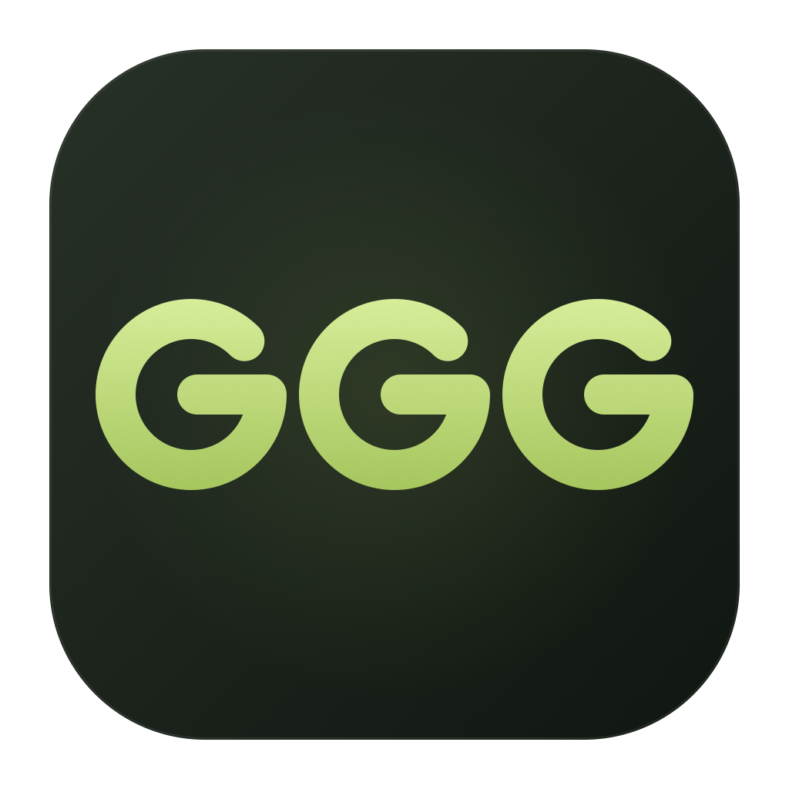

<p align="center"></p>

# Good Gameble Games

**Play the GOG Witcher 3 remaster on your Mac without a paid CrossOver license.**

Good Gameble Games is a free, open-source macOS launcher built with SwiftUI and Wine. This started with one goal: get a legally owned GOG copy of **The Witcher 3: Wild Hunt — Remastered** running on an Apple Silicon Mac, with Direct3D 12 and MetalFX upscaling.

**In development · 0.15.0 · GPL-3.0-or-later**

The current source includes the **0.15.0 interface update**: one setup-and-games page, numbered first-run steps, a compact game list after setup, and a separate Logs window. Slogans, free-game downloads and benchmark controls have been removed. See the [changelog](CHANGELOG.md#0150--unreleased) and [setup guide](docs/GETTING_STARTED.md).

[Download the latest published early-access app (0.14.1)](https://github.com/texcut/Good-Gameble-Games/releases/tag/v0.14.1). **That download still uses the previous interface.** Build from the current source for the new layout; a 0.15.0 binary release has not been published. App archives target Apple Silicon, are not Apple-notarized, and require the separately prepared DX12 runtime described below to reproduce the Witcher setup.

**Fork it, change it, improve it, and share your version.** Contributions and experiments are welcome. When distributing changes, retain the license/notices and provide the corresponding source as required by [GPL-3.0-or-later](LICENSE). See [CONTRIBUTING.md](CONTRIBUTING.md).

## What has actually been tested?

**Only one game is claimed as tested for this release: the GOG Witcher 3 remaster, version 5.01, with the exact executable hash below.** It was installed, launched and played on an **Apple M3 Max, macOS 27.2**, using **Wine 11.16** and Apple's **Evaluation environment for Windows games 4.0 beta 3**. The GPU core count and memory configuration were not recorded.

Other games, other Macs, other Witcher builds, the Steam edition, ray tracing and frame generation are not validated by this release. This is early-access software, not a full-game stability certification.

### Observed FPS and settings experiments

These are individual HUD readings and user observations from development sessions, **not averages, 1% lows or controlled benchmark comparisons**. Scenes, time of day and settings varied. Do not attribute every difference to a single option or to the patch.

- **2560×1440, Low Power Mode enabled, before MetalFX was confirmed:** **17.22 FPS**, GPU **58.02 ms**. The HUD explicitly reported Low Power Mode.
- **After disabling Low Power Mode:** the tester reported improved playability, initially reaching about **35 FPS**. This was a separate run, not a matched-scene measurement.
- **1920×1080, before MetalFX was confirmed:** **44.78 FPS**, GPU **23.54 ms** in the captured scene.
- **1344×756, before MetalFX was confirmed:** **57.93 FPS**, GPU **18.45 ms** in the captured scene. Lowering resolution was the clearest repeatable improvement reported by the tester.
- **2560×1440 output with temporal MetalFX active:** **1707×960 input → 2560×1440 output**, **41.05 FPS**, GPU **24.30 ms** in the captured night scene. This confirms the upscaler was running; it does not establish a fixed speedup over the earlier scenes.
- **Other experiments:** MSync on/off, Metal 3/4 and low/high presets produced no clear improvement reported by the tester. Day/night ceilings of roughly **48/38 FPS** were also reported without a complete settings record.

The game was playable, but **sustained 60 FPS at 1440p was not achieved in these tests**. These numbers are observations from one Mac and game build, not targets for other systems. Keep Low Power Mode off when comparing performance and measure the same scene with the FPS overlay enabled.

## The GOG DLSS / MetalFX workaround

The game's Wine detection blocks some graphics paths. The instruction changes described in the [community technical reference](https://github.com/lypiut/macOs-crossover-game-patch/blob/main/games/witcher-3/TECHNICAL.md) were documented for a Steam executable. **Our GOG 5.01 executable had the same SHA-256**, so this exact binary could use the same changes. That is evidence for this file, not for every GOG or Steam release.

Supported original `bin/x64_dx12/witcher3.exe`:

```text
2df765398a3d1f165db418271be7200178320a4466817379f2fa0dc0001fb101
```

With a prepared D3DMetal runtime connected:

1. Close the game and select the **original** `bin/x64_dx12/witcher3.exe` as its library executable.
2. Use the game row’s **Graphics and performance** button (sliders icon), enable **Use MetalFX (DLSS)**, and save. The app checks the original hash, expected instructions and output hash before using a separate `witcher3-gggmac-metalfx.exe` beside it. **The original executable stays untouched.**
3. Start the game from the app and select **DLSS** in the game's graphics options. Here the DLSS interface routes to **Apple MetalFX temporal upscaling** through the runtime's NGX/NVAPI bridge.
4. Enable **Show FPS and frame times** to verify that the HUD shows MetalFX scaling input and target resolutions. A saved checkbox alone does not prove upscaling is active.

The companion's expected SHA-256 is:

```text
5dc266a88709f0bfe3573ef5f5e3d055dfcd6a5a698a8ab4aa390be34015e419
```

The copy changes three Wine-specific feature gates; real device capability checks remain. It does not supply unsupported graphics features, and our test confirms temporal upscaling only. Disabling MetalFX returns Play to the original. Unknown executables are refused: **5.0.0, 5.0.2 or any future update is not supported merely because its version looks similar.** No game executable or NVIDIA game plugin is distributed here. Implementation and bridge details are in [graphics and compatibility](docs/GRAPHICS.md).

## Setup and current limits

The launcher requires **macOS 14+**. The managed Wine download requires **macOS 15+**, plus Rosetta 2 on Apple Silicon. That managed runtime provides the Direct3D 10/11 DXMT path.

**Witcher 3 / Direct3D 12 setup is currently manual.** The tested setup uses compatible Wine Libraries **4.6.4-beta.1 / Wine 11.16** and the owner's Apple evaluation download **4.0 beta 3**. The graphical Apple-payload importer is not included. See [the advanced D3DMetal setup limitations](docs/GRAPHICS.md#d3dmetal-advanced-setup) before expecting a clean-machine installation to work. Downloading managed Wine alone does not reproduce the Witcher setup.

You need to own the game and obtain Apple's evaluation environment directly from Apple, using your own sign-in and license acceptance. Wine, Apple graphics libraries and game files are not bundled. CrossOver is not required by the tested configuration.

Once your compatible runtime/environment is prepared:

1. In **Setup → 1. Connect a runtime**, connect the runtime and use its prepared environment.
2. Download the GOG **offline** installer: the small setup `.exe` and **every** numbered `.bin` part, together in one folder. The GOG Galaxy downloader is not the offline installer.
3. Use **3. Install or add a game → Run installer…**, finish installation, then add the DX12 executable to the library.
4. Apply the supported MetalFX setup above and press **Play** on the game row.

[Getting started](docs/GETTING_STARTED.md) covers the launcher, local library and installers. Graphical setup for the managed Direct3D 10/11 path is available, but it is separate from the manually prepared Witcher DX12 environment.

## One-page setup

On a first run, the main page shows three numbered steps:

1. **Connect a runtime.** Select a compatible Wine executable. For Witcher 3, use a prepared D3DMetal runtime; the optional standard Wine download only supplies the Direct3D 10/11 path.
2. **Create an environment.** Enter a name and create its Windows filesystem on the same page.
3. **Install or add a game.** Run a local installer or select an installed `.exe`. After installation, choose the game's executable and press Play.

Once a game has been added, the main page opens as a compact game list. **Setup** reopens runtime and environment controls on the same page. **Install…** runs an installer in an existing environment, and **Add game** links an installed executable.

**Logs** opens a separate window for process output, diagnostic exports and optional Wine/graphics checks. Open it from the header or **Help → Show Logs** (Shift–Command–L). There are no free-game downloads or benchmark controls in the player interface. Existing library entries and saved environments are retained; removing the last game restores setup guidance.

## Build and run

Install Swift 6 or later through Xcode or the Command Line Tools. No external Swift packages are required.

```sh
git clone https://github.com/texcut/Good-Gameble-Games.git
cd Good-Gameble-Games
bash scripts/swift-tool.sh test
bash scripts/build-app.sh release
open "dist/Good Gameble Games.app"
```

Builds are **ad-hoc signed and not Apple-notarized** by default. Downloaded builds may be blocked by Gatekeeper. Developer ID signing and notarization are separate maintainer steps.

To prepare local app/source archives and checksums:

```sh
python3 -m unittest discover -s scripts/tests
bash scripts/prepare-release.sh
```

## Your files and privacy

The earlier working name was GGGMac. Internal Swift targets, the bundle identifier and `~/Library/Application Support/GGGMac/` are retained so existing libraries keep working. That folder contains library metadata, environments, runtimes and logs. Removing a library entry leaves the game files in place. Closing the launcher leaves Windows programs running; **Stop environment** explicitly ends them.

Diagnostics are exported locally with common home paths and credential patterns redacted; review the file before sharing it. Nothing is uploaded automatically. The managed runtime downloads only when requested.

## Help improve it

Forks, fixes, better setup flows and clearly documented compatibility reports are welcome. Include the exact game store/build, executable hash, Mac, macOS, runtime, resolution, scene and measured results. Please distinguish a successful launch from sustained gameplay or a repeatable benchmark.

- [Development](docs/DEVELOPMENT.md) and [release preparation](docs/RELEASING.md)
- [Changelog](CHANGELOG.md) and [component notices](THIRD_PARTY_NOTICES.md)
- [License](LICENSE)

Good Gameble Games is an independent project, unaffiliated with Apple, CodeWeavers, Wine, GOG or CD PROJEKT RED.
